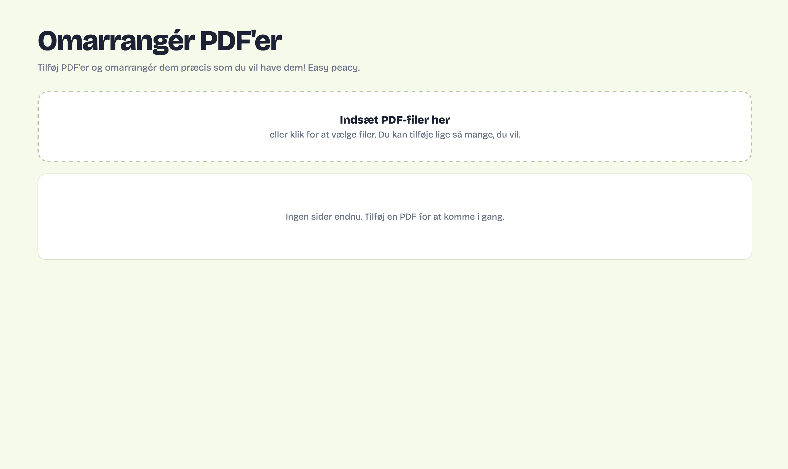

## Omarrangér PDF'er
Every half a year, during the exam period, I have to rearrange my PDFs. I often have many PDFs I want to merge, and I also want to mix some of them together. I always find this tool online, but I just decided to vibecode my own this time. Easy peasy.

Open <b>Omarrangér PDF'er</b> <a href="https://signeursula.github.io/VIBECODING/omarranger-PDF/index.html" target="_blank">HERE</a>.  

  

