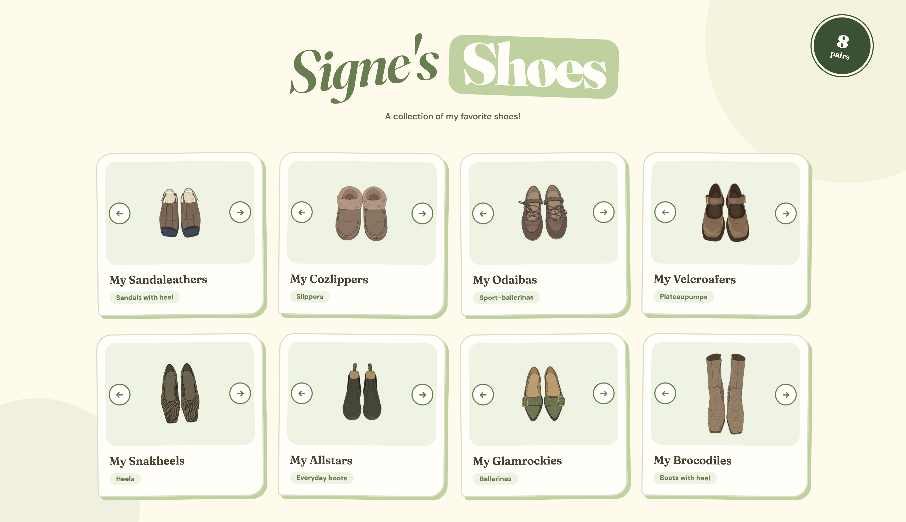

## Signe's shoes
I wanted to experience with letting AI turn images into illustrations. So I photographed my shoes, and used Figma's AI to make it cartoonish. Afterwards I made a simple website design with Claude. The result became a little portfolio of my favorite shoes!

Open <b>Signe's shoes</b> <a href="https://signeursula.github.io/VIBECODING/signes-shoes/index.html" target="_blank">HERE</a>.  

  
